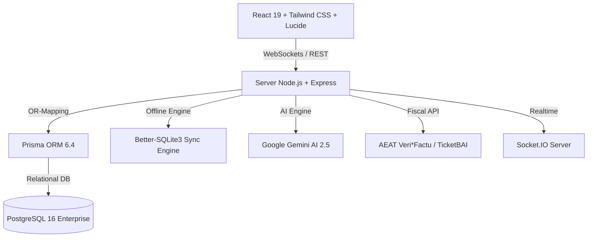

<div align="center">


# SOTIUM POS Enterprise

### **Plataforma Integral de Gestión Hostelera y Punto de Venta Enterprise**
*Sistema TPV multi-compañía, multi-centro, offline-first con Inteligencia Artificial Gemini, Veri*Factu, TicketBAI, KDS, Control de Producción, APPCC, RRHH y Business Intelligence.*

[](https://github.com/sotium/sotium-pos)
[](./LICENSE)
[](https://www.typescriptlang.org/)
[](https://react.dev/)
[](https://nodejs.org/)
[](https://expressjs.com/)
[](https://www.prisma.io/)
[](https://www.postgresql.org/)
[](https://www.sqlite.org/)
[](https://vitest.dev/)
[](./docs/VERIFACTU.md)

[📐 Arquitectura](./docs/ARCHITECTURE.md) • [📖 Documentación API](./docs/API.md) • [⚡ Guía de Instalación](./docs/INSTALL.md) • [🚀 Despliegue](./docs/DEPLOYMENT.md) • [💬 FAQ](./docs/FAQ.md)

</div>

---

## 📋 Resumen Ejecutivo

**SOTIUM POS Enterprise** es la solución tecnológica de referencia para la industria de la hostelería, restauraicón organizada, franquicias y colectividades. Diseñado desde cero bajo principios de **Clean Architecture** y arquitectura híbrida **Offline-First**, Sotium POS garantiza la continuidad operativa absoluta del negocio incluso ante la caída total de la red eléctrica o conexión a Internet.

Integra en un único ecosistema modular la gestión del TPV táctil, comandero móvil, plano interactivo de comedor, cocina (KDS), inventarios con escandallos complejos, producción industrial, compras, contabilidad oficial, nóminas y RRHH, APPCC e higiene alimentaria, gestión de activos/SAT, Business Intelligence avanzado e Inteligencia Artificial generativa basada en **Google Gemini 2.5 Flash**.

---

## 🌟 Módulos Principales

| Módulo | Descripción | Documentación |
| :--- | :--- | :---: |
| **TPV & Comandas** | Venta táctil ultrarrápida, división de tickets, cobro multi-tarjeta, tarifas por sala/terraza. | [Ver Doc](./docs/TPV.md) |
| **Cocina (KDS)** | Sistema de visualización para cocina por partidas, avisos sonoros, tiempos de preparación. | [Ver Doc](./docs/KDS.md) |
| **Reservas & CRM** | Motor de reservas con plano de ocupación, lista de espera, no-show predictor e historial del cliente. | [Ver Doc](./docs/CRM.md) |
| **Producción & Escandallos** | Órdenes de fabricación, escandallos multinivel, control de mermas y trazabilidad de lotes. | [Ver Doc](./docs/PRODUCTION.md) |
| **Compras & Almacén** | Pedidos a proveedores, albaranes, control de caducidades, comparador de precios y reconciliación 3-way. | [Ver Doc](./docs/INTEGRATIONS.md) |
| **Finanzas & Caja** | Arqueos de caja (Z/X), contabilidad PGC, facturación oficial Facturae, gestión de tesorería. | [Ver Doc](./docs/FINANCE.md) |
| **RRHH & Control Horario** | Fichajes con trazabilidad legal española, cuadrantes de turnos, gestión de vacaciones y nóminas. | [Ver Doc](./docs/HR.md) |
| **Cumplimiento Fiscal** | Módulo nativo Veri*Factu (AEAT) y TicketBAI (Diputaciones Forales Pais Vasco). | [Ver Doc](./docs/VERIFACTU.md) |
| **Calidad APPCC** | Registros de temperatura, auditorías sanitarias, trazabilidad de alérgenos UE 1169/2011. | [Ver Doc](./docs/QUALITY.md) |
| **Mantenimiento SAT** | Gestión de activos, mantenimiento preventivo/correctivo y control de recambios. | [Ver Doc](./docs/MAINTENANCE.md) |
| **BI & Gemini AI** | Cuadro de mando ejecutivo, predicción de ventas, optimización de stock y asistente conversacional. | [Ver Doc](./docs/BI.md) |
| **Multi-Compañía** | Gestión centralizada de múltiples marcas, cadenas y centros de trabajo con consolidación. | [Ver Doc](./docs/BACKOFFICE.md) |

---

## 🏗️ Arquitectura del Sistema

Sotium POS combina lo mejor de dos mundos: la inmediatez y resiliencia de la base de datos local **SQLite (Better-SQLite3)** en terminales locales con la potencia de **PostgreSQL 16** mediante **Prisma ORM** en el servidor central.



Para más detalles, consulte la [Documentación Completa de Arquitectura](./docs/ARCHITECTURE.md).

---

## ⚙️ Tecnologías Utilizadas

### **Frontend**
* **React 19.0.1**: Biblioteca UI principal con Server/Client Components.
* **Tailwind CSS 4.1**: Framework CSS de utilidad cero para diseño enterprise responsivo.
* **Lucide React 0.546**: Sistema coherente de iconografía vectorial.
* **Motion 12.23**: Motor de animaciones fluidas de alta performance.
* **Recharts 3.10**: Visualización interactiva de gráficos financieros y analíticos.

### **Backend & Base de Datos**
* **Node.js 22.14 & Express 4.21**: Runtime y servidor REST API de alto rendimiento.
* **TypeScript 5.8.2**: Tipado estático estricto en el 100% del código base.
* **Prisma ORM 6.4**: ORM de última generación para modelado y consultas con seguridad de tipos.
* **PostgreSQL 16**: Motor relacional primario para despliegues centralizados.
* **Better-SQLite3 13.0**: Motor de base de datos embebido para redundancia offline local.
* **Socket.IO 4.8**: Comunicación bidireccional en tiempo real para KDS y comanderos.
* **Winston 3.19 & Zod 4.4**: Sistema de logs estructurados y validación estricta de esquemas.

---

## 🚀 Instalación Rápida

### **Requisitos Previos**
* Node.js `>= 20.0.0`
* npm `>= 10.0.0`
* PostgreSQL `>= 15` *(Opcional en modo desarrollo local SQLite)*

### **Pasos de Instalación**

1. **Clonar el repositorio:**
   ```bash
   git clone https://github.com/sotium/sotium-pos.git
   cd sotium-pos
   ```

2. **Instalar dependencias:**
   ```bash
   npm install
   ```

3. **Configurar variables de entorno:**
   Cree un archivo `.env` basado en `.env.example`:
   ```bash
   cp .env.example .env
   ```

4. **Inicializar esquema de base de datos:**
   ```bash
   npx prisma db push
   ```

5. **Iniciar el servidor de desarrollo:**
   ```bash
   npm run dev
   ```
   La aplicación estará disponible en `http://localhost:3000`.

---

## 🧪 Pruebas y Calidad de Código

Sotium POS cuenta con una suite de pruebas automatizadas mediante **Vitest** y **Supertest** con más de 25 suites covering todos los módulos críticos.

```bash
# Ejecutar la suite completa de pruebas
npx vitest run

# Comprobar tipado estático TypeScript
npm run lint

# Compilar para producción
npm run build
```

---

## 📄 Licencia

Este proyecto está distribuido bajo los términos de la Licencia **MIT**. Consulte el archivo [LICENSE](./LICENSE) para más detalles.

---

<div align="center">

**Desarrollado con ❤️ por el equipo de Sotium Software Enterprise**  
*Garantizando la excelencia operativa en la hostelería moderna.*

</div>
