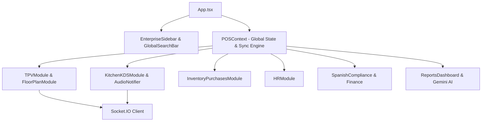
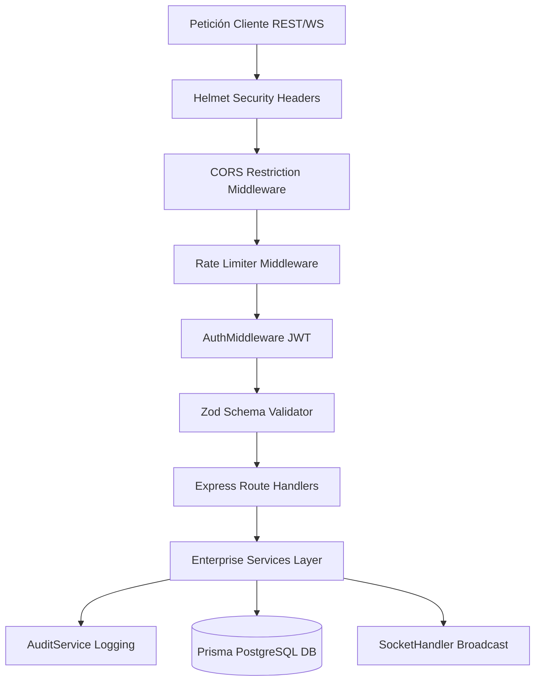
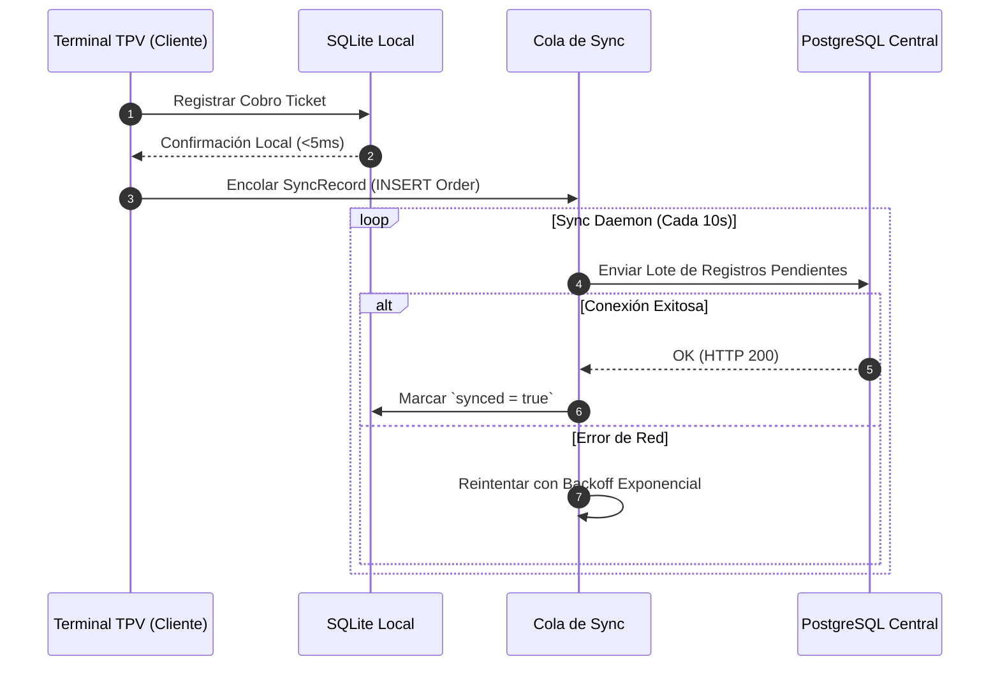

# Especificación de Arquitectura de Sotium POS Enterprise

---

## 📌 Índice
1. [Introducción y Objetivos](#1-introducción-y-objetivos)
2. [Principios de Diseño de Sistema](#2-principios-de-diseño-de-sistema)
3. [Vista General de la Arquitectura](#3-vista-general-de-la-arquitectura)
4. [Diagramas de Arquitectura (Mermaid)](#4-diagramas-de-arquitectura-mermaid)
   - [4.1 Capa Frontend](#41-capa-frontend)
   - [4.2 Capa Backend REST & WebSocket](#42-capa-backend-rest--websocket)
   - [4.3 Capa de Persistencia Híbrida (PostgreSQL + SQLite)](#43-capa-de-persistencia-híbrida)
   - [4.4 Motor Offline y Sincronización](#44-motor-offline-y-sincronización)
   - [4.5 Integración de IA Gemini 2.5](#45-integración-de-ia-gemini-25)
   - [4.6 Arquitectura Fiscal (Veri*Factu & TicketBAI)](#46-arquitectura-fiscal)
5. [Estructura del Proyecto y Separación de Responsabilidades](#5-estructura-del-proyecto-y-separación-de-responsabilidades)
6. [Estrategia de Seguridad y Garantía de Inmutabilidad](#6-estrategia-de-seguridad-y-garantía-de-inmutabilidad)

---

## 1. Introducción y Objetivos

**Sotium POS Enterprise** está concebido como una plataforma distribuida, escalable y tolerante a fallos para la gestión integral de establecimientos hosteleros, desde locales independientes hasta grandes cadenas y franquicias.

El objetivo principal de la arquitectura es garantizar un **SLA operativo del 99.99%** a nivel de punto de venta, impidiendo que interrupciones de conectividad a Internet o la degradación de servicios en la nube paralicen la toma de comandas, el envío de tiques a cocina o el cobro a clientes.

---

## 2. Principios de Diseño de Sistema

* **Clean Architecture & Domain-Driven Design (DDD):** Desacoplamiento estricto entre el dominio de negocio (servicios e interfaces), la infraestructura (base de datos, red, impresoras) y las vistas (React).
* **Offline-First Resilience:** La operación local utiliza almacenamiento persistente embebido SQLite (`better-sqlite3`). Las operaciones de venta se confirman localmente en milisegundos y se sincronizan asíncronamente con el clúster central de PostgreSQL.
* **Typing End-to-End (TypeScript):** Contrato de tipos unificado compartido entre frontend y backend mediante interfaces estructuradas en `src/types/`.
* **State Immutability & Event Tracing:** Toda modificación crítica de estado (cierres de caja, anulaciones de comandas, registros fiscales) genera un evento de auditoría firmado y registrado en la tabla `AuditLog`.

---

## 3. Vista General de la Arquitectura

```text
+-----------------------------------------------------------------------------------+
|                                  CAPA FRONTEND                                    |
|   React 19 + Tailwind CSS + Lucide Icons + Motion + Recharts + WebSockets Client |
+-----------------------------------------------------------------------------------+
                                          |
                                    HTTPS / WSS
                                          v
+-----------------------------------------------------------------------------------+
|                                  CAPA BACKEND                                     |
|   Express JS + Middlewares (JWT, Helmet, RateLimit, Zod) + Socket.IO Server      |
+-----------------------------------------------------------------------------------+
       |                                   |                                  |
       v                                   v                                  v
+------------------+             +--------------------+            +-------------------+
|   PERSISTENCIA   |             |   MOTOR OFFLINE    |            |   INTELIGENCIA    |
|   Prisma ORM     |             |   SQLite Engine    |            |   ARTIFICIAL      |
|   PostgreSQL 16  |             |  Better-SQLite3    |            |   Gemini 2.5      |
+------------------+             +--------------------+            +-------------------+
```

---

## 4. Diagramas de Arquitectura (Mermaid)

### 4.1 Capa Frontend



### 4.2 Capa Backend REST & WebSocket



### 4.3 Capa de Persistencia Híbrida

```mermaid
graph LR
    subgraph Servidor Central (Cloud)
        Prisma[Prisma Client ORM 6.4] --> Postgres[(PostgreSQL 16 Cluster)]
    end

    subgraph Terminal Local POS (Edge)
        SQLiteSyncEngine[SQLite Sync Engine] --> LocalSQLite[(Better-SQLite3 DB)]
    end

    SQLiteSyncEngine <--> |Replicación & Resolve Conflictos| Prisma
```

### 4.4 Motor Offline y Sincronización



### 4.5 Integración de IA Gemini 2.5

```mermaid
graph TD
    UserQuery[Pregunta del Usuario / Solicitud de Análisis] --> Service[AIService / Gemini Connector]
    Service --> PromptEngine[Context & Prompt Engineering]
    PromptEngine --> APIKeyCheck{GEMINI_API_KEY Presente?}
    
    APIKeyCheck -- Sí --> GeminiSDK[@google/genai SDK Call]
    APIKeyCheck -- No / Fail --> DeterministicEngine[Deterministic Rules Engine Fallback]
    
    GeminiSDK --> ResponseParse[JSON Response Parsing & Validation]
    DeterministicEngine --> ResponseParse
    ResponseParse --> UI[Interfaz de Usuario / Módulo BI]
```

---

## 5. Estructura del Proyecto y Separación de Responsabilidades

```text
src/
├── components/          # Componentes de Interfaz de Usuario por Módulo
│   ├── bi/              # Componentes de Analytics & Business Intelligence
│   ├── finance/         # Tesorería, Facturación y PGC
│   ├── floorplan/       # Plano de Salas y Editor de Mesas
│   ├── hr/              # Gestión de Plantilla, Control Horario y Nóminas
│   ├── integrations/    # Webhooks, Tokens OAuth y Cola Dead-Letter
│   ├── inventory/       # Stock, Almacenes, Mermas y Escandallos
│   ├── kds/             # Monitores de Cocina y Partidas
│   ├── maintenance/     # Activos, SAT y Mantenimiento Preventivo
│   ├── mobile/          # Vistas Optimizadas para Comanderos y Delivery
│   ├── multicompany/    # Gestión Centralizada Multi-Empresa y Sedes
│   ├── navigation/      # Sidebar Enterprise y Búsqueda Global
│   ├── production/      # Recetas, Lotes y Trazabilidad de Producción
│   ├── purchases/       # Pedidos, Albaranes y Facturas de Proveedor
│   ├── quality/         # APPCC, Temperaturas, Alérgenos y Limpieza
│   └── reservations/    # Motor de Reservas y Ocupación
├── context/             # Estado Global React (POSContext)
├── data/                # Semillas de Datos e Inicialización Demo
├── db/                  # Prisma Client, SQLite Engine y Sync Logic
├── middleware/          # Autenticación JWT, Middlewares Express
├── server/
│   ├── routes/          # Controladores de Endpoints REST API
│   └── sockets/         # Handler de Socket.IO en Tiempo Real
├── services/            # Lógica de Negocio y Servicios de IA
├── tests/               # Suites de Pruebas Unitarias e Integración (Vitest)
├── types/               # Definiciones TypeScript de Dominio
├── utils/               # Formateadores, Manejo de Monedas y Validadores
└── validators/          # Esquemas Zod de Entrada API
```

---

## 6. Estrategia de Seguridad y Garantía de Inmutabilidad

1. **Tokens JWT:** Firma con clave secreta de alta entropía en `src/middleware/authMiddleware.ts`.
2. **Encadenamiento Hash en Facturación:** Cada tique verifactu incluye `previousHash` y `currentHash` utilizando algoritmos SHA-256 para prevenir alteración retroactiva.
3. **Auditoría Global:** La clase `AuditService` captura usuario, rol, IP, recurso, acción y payload previo/posterior.
