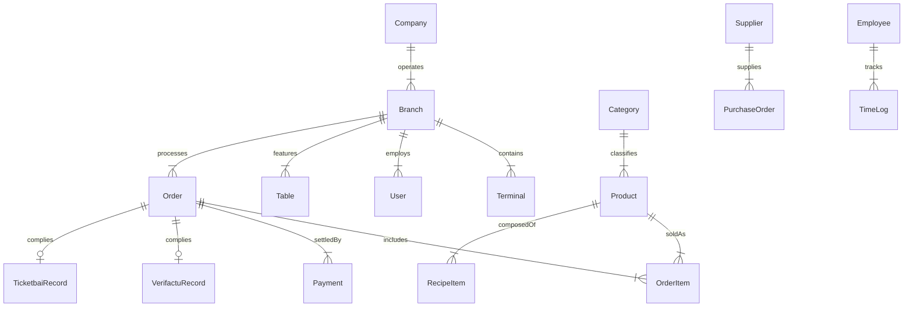

# Especificación de Base de Datos - Sotium POS Enterprise

---

## 📌 Índice
1. [Estrategia de Almacenamiento Relacional](#1-estrategia-de-almacenamiento-relacional)
2. [Prisma ORM & PostgreSQL 16](#2-prisma-orm--postgresql-16)
3. [Esquema Completo de Entidades (ERD)](#3-esquema-completo-de-entidades)
4. [Diccionario de Datos Detallado](#4-diccionario-de-datos-detallado)
   - [4.1 Núcleo de Organización y Acceso](#41-núcleo-de-organización-y-acceso)
   - [4.2 TPV, Ventas y Comandas](#42-tpv-ventas-y-comandas)
   - [4.3 Carta, Productos y Escandallos](#43-carta-productos-y-escandallos)
   - [4.4 Reservas y Clientes CRM](#44-reservas-y-clientes-crm)
   - [4.5 Almacén, Compras y Producción](#45-almacén-compras-y-producción)
   - [4.6 Recursos Humanos y Fichajes](#46-recursos-humanos-y-fichajes)
   - [4.7 Fiscal, Auditoría y Sistema](#47-fiscal-auditoría-y-sistema)
5. [Estrategias de Indexación y Rendimiento](#5-estrategias-de-indexación)

---

## 1. Estrategia de Almacenamiento Relacional

**Sotium POS Enterprise** utiliza un modelo híbrido relacional de alta disponibilidad.
* **Base de Datos Central (Servidor / Cloud):** **PostgreSQL 16 Enterprise**, gestionada mediante **Prisma ORM 6.4**.
* **Base de Datos Local (Terminal TPV):** **SQLite (`better-sqlite3`)**, replicada mediante el motor de sincronización `SQLiteSyncEngine`.

---

## 2. Prisma ORM & PostgreSQL 16

El esquema se define formalmente en `prisma/schema.prisma`. Proporciona integridad referencial, restricciones de unicidad, migración de esquemas tipada y transacciones ACID.

---

## 3. Esquema Completo de Entidades (Diagrama Mermaid)

---

## 4. Diccionario de Datos Detallado

### 4.1 Núcleo de Organización y Acceso

#### Tabla `Company`
Almacena las empresas o marcas corporativas registradas.
* `id` (String, PK): Identificador único UUID.
* `name` (String): Razon social o nombre comercial.
* `taxId` (String): CIF / NIF fiscal.
* `createdAt` (DateTime): Fecha de creación.

#### Tabla `Branch`
Representa un centro de trabajo, restaurante o establecimiento físico.
* `id` (String, PK): UUID del centro.
* `companyId` (String, FK): Referencia a `Company`.
* `name` (String): Nombre del restaurante (ej: "Sotium Gran Vía").
* `address` (String): Dirección física completa.

#### Tabla `User`
Almacena las credenciales y perfiles de acceso.
* `id` (String, PK): UUID de usuario.
* `branchId` (String, FK): Referencia a `Branch`.
* `username` (String, Unique): Nombre de usuario.
* `passwordHash` (String): Hash Bcrypt de contraseña.
* `role` (Enum): `ADMIN`, `GERENTE`, `ENCARGADO`, `CAMARERO`, `COCINA`, `REPARTIDOR`.

---

### 4.2 TPV, Ventas y Comandas

#### Tabla `Order`
Representa una venta o comanda activa/cerrada.
* `id` (String, PK): UUID de la orden.
* `branchId` (String, FK): Centro de trabajo.
* `tableId` (String, FK, Nullable): Mesa asignada.
* `orderNumber` (String): Código secuencial de factura/tique (ej: `F2026-00104`).
* `status` (Enum): `OPEN`, `SERVED`, `CLOSED`, `CANCELLED`.
* `totalAmount` (Float): Importe total IVA incluido.
* `paymentMethod` (Enum): `CASH`, `CARD`, `BIZUM`, `ROOM_CHARGE`.

#### Tabla `OrderItem`
Líneas de detalle de una orden.
* `id` (String, PK): UUID de la línea.
* `orderId` (String, FK): Referencia a `Order`.
* `productId` (String, FK): Referencia a `Product`.
* `quantity` (Float): Cantidad consumida.
* `unitPrice` (Float): Precio unitario en el momento de la venta.
* `course` (Enum): `PRIMERO`, `SEGUNDO`, `POSTRE`, `BEBIDA`.

---

### 4.3 Carta, Productos y Escandallos

#### Tabla `Product`
Artículos de la carta de venta o materia prima.
* `id` (String, PK): UUID de producto.
* `categoryId` (String, FK): Categoría.
* `name` (String): Nombre del plato o bebida.
* `price` (Float): PVP de venta al público.
* `vatRate` (Float): Tipo de IVA aplicable (ej: `10.0` para restauración).
* `kdsStation` (Enum): `COCINA`, `BARRA`, `HORNO`, `POSTRES`.

---

### 4.4 Reservas y Clientes CRM

#### Tabla `Reservation`
* `id` (String, PK): UUID de reserva.
* `customerName` (String): Nombre del comensal.
* `partySize` (Int): Número de cubiertos.
* `reservationTime` (DateTime): Fecha y hora reservada.
* `noShowProbability` (Float): Predicción calculada por la IA Gemini.

---

## 5. Estrategias de Indexación y Rendimiento

Para optimizar las consultas en picos de trabajo:
* Índice compuesto `[branchId, status]` en la tabla `Order` para listado ultrarrápido de comandas abiertas.
* Índice único `[orderNumber]` para cumplimiento fiscal e inmutabilidad.
* Índice temporal `[issueTimestamp]` en registros de auditoría y ventas.
