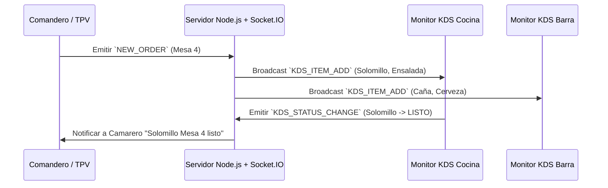

# Especificación del Sistema de Pantallas de Cocina (KDS) - Sotium POS Enterprise

---

## 📌 Índice
1. [Visión General del Monitor KDS (Kitchen Display System)](#1-visión-general)
2. [Arquitectura de Comunicación en Tiempo Real (Socket.IO)](#2-arquitectura-en-tiempo-real)
3. [Gestión por Partidas de Cocina](#3-gestión-por-partidas)
4. [Estados de los Tiques y Control de Tiempos](#4-estados-de-los-tiques)
5. [Notificaciones Sonoras y Alertas de Retraso](#5-notificaciones-sonoras)
6. [Modo Recetas e Integración con Fichas Técnicas](#6-modo-recetas)

---

## 1. Visión General

El módulo **KDS (Kitchen Display System)** (`src/components/kds/KitchenKDSModule.tsx`) reemplaza las impresoras tradicionales de papel en cocina por monitores táctiles interactivos de alta durabilidad.

Garantiza una comunicación perfecta entre los camareros de sala y el equipo de cocina, reduciendo los tiempos de preparación hasta en un 35% y eliminando las pérdidas de comanda.

---

## 2. Arquitectura en Tiempo Real

El KDS se conecta al servidor Express mediante canales WebSockets seguros administrados por `Socket.IO` (`src/server/sockets/kdsSocketHandler.ts`):

---

## 3. Gestión por Partidas de Cocina

El sistema permite filtrar las comandas entrantes por la partida de trabajo asignada a cada monitor:
* **Pantalla de Fríos / Entrantes**
* **Pantalla de Fuegos / Plancha**
* **Pantalla de Horno / Pizzas**
* **Pantalla de Postres**
* **Pantalla de Expeditador / Jefe de Pase (Visión Global)**

---

## 4. Estados de los Tiques y Control de Tiempos

Cada tarjeta de comanda muestra el tiempo transcurrido desde su envío y cambia de color según los umbrales configurados:
* 🟩 **Verde (Normal):** < 10 minutos.
* 🟨 **Amarillo (Atención):** 10 a 20 minutos.
* 🟥 **Rojo (Urgente / Retraso):** > 20 minutos.

---

## 5. Notificaciones Sonoras

Mediante el módulo de sonido `audioNotifier.ts`, el monitor KDS emite avisos acústicos diferenciados al entrar una nueva comanda, un cambio de marchando o una anulación prioritaria.

---

## 6. Modo Recetas e Integración con Escandallos

El cocinero puede pulsar sobre cualquier plato en la pantalla KDS para abrir la **Ficha Técnica Instantánea**, visualizando los ingredientes exactos, foto de emplatado, gramajes y advertencias de alérgenos.
