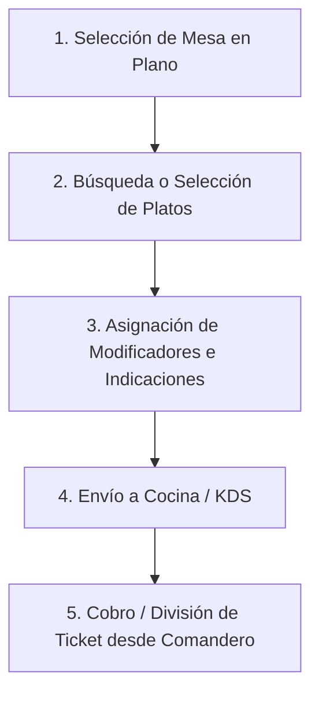

# Especificación de la Aplicación Móvil y Comanderos - Sotium POS Enterprise

---

## 📌 Índice
1. [Visión General de Comanderos Móviles](#1-visión-general)
2. [Arquitectura Web Progresiva (PWA & Responsiva)](#2-arquitectura-web-progresiva)
3. [Flujos de Trabajo del Comandero de Sala](#3-flujos-de-trabajo-del-comandero)
4. [Soporte Offline en Dispositivos Móviles](#4-soporte-offline)
5. [Optimizaciones Táctiles y Gestos de Interfaz](#5-optimizaciones-táctiles)

---

## 1. Visión General

El módulo móvil de **Sotium POS Enterprise** (`src/components/mobile/MobileModule.tsx`) está diseñado para optimizar el trabajo de los camareros en sala, terraza y barra utilizando smartphones o tablets Android/iOS de cualquier tamaño de pantalla.

---

## 2. Arquitectura Web Progresiva (PWA)

No requiere instalación desde tiendas de aplicaciones (App Store / Google Play). Al acceder a la URL local del servidor (`http://192.168.1.100:3000`), el comandero se ejecuta como una Web App a pantalla completa con soporte de touch targets de al menos **48px**, previniendo toques accidentales.

---

## 3. Flujos de Trabajo del Comandero

### **Puntos Clave del Flujo:**
* **Búsqueda Instantánea:** Filtrado de productos por texto o categoría en < 50ms.
* **Modificadores Obligatorios/Opcionales:** Ventana emergente para seleccionar punto de la carne, acompañamientos o alérgenos.
* **Cobro Fraccionado Móvil:** Permite dividir el pago por comensal o importe directamente en la mesa con datáfono inalámbrico.

---

## 4. Soporte Offline en Dispositivos Móviles

Si el camarero pierde la cobertura Wi-Fi en un punto ciego de la terraza:
* Las comandas tomadas se guardan en el almacenamiento `localStorage` / `IndexedDB` local del dispositivo.
* Un aviso sonoro y vibración notifican al camarero de la falta de red.
* En cuanto el dispositivo recupera señal, las comandas encoladas se envían automáticamente al KDS de cocina.

---

## 5. Optimizaciones Táctiles

* **Navegación por Desplazamiento (Swipe):** Gestos laterales para cambiar entre categorías de la carta.
* **Modo Oscuro Automático:** Reducción del consumo de batería en pantallas OLED y mayor confort visual en ambientes de luz tenue (discotecas, restaurantes de cena).
